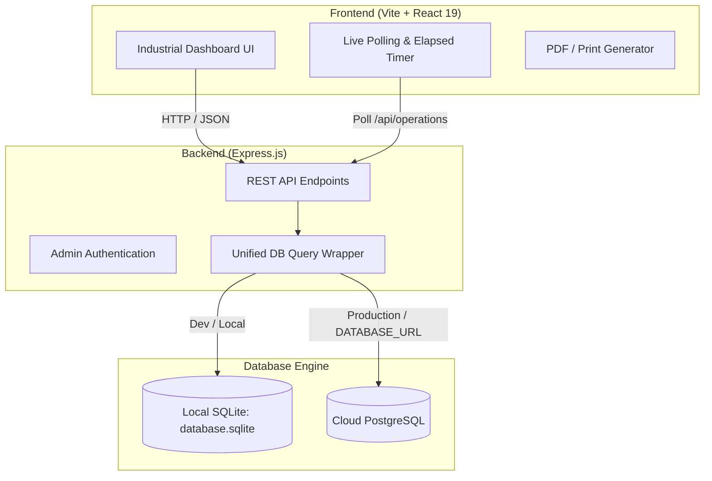

# ⚡ Cutting Monitoring System (CMS)

A full-stack, real-time industrial production and machine tracking web application designed for cutting workshops (**Laser**, **Plasma**, and **Oxy-fuel / Oxycoupage**). 

The system enables workshop operators and plant managers to track cutting operations in real time, record manual retro-active sheets, compute material consumption and machine runtimes, and generate printable preparation orders (*Bons de préparation*) and PDF reports.

---

## 📌 Features

- **⏱️ Real-Time Machine Tracking**:
  - Live operation timer for active machines (**LASER**, **PLASMA**, **OXY**).
  - Enforces single-operation-per-machine constraint (prevents overlapping jobs).
  - Automatic synchronization and polling every 5 seconds across connected clients.

- **📋 Industrial Job Details**:
  - Track **Program Name** (`programme`), **Job/BL Number**, **Operator Name**, **Client**, and **Material Origin** (*CLIENT* vs. *INTERNE*).
  - Material specifications: **Type** (Steel, Stainless, Aluminum, etc.), **Thickness (mm)**, **Dimensions**, **Sheet Count** (*Nombre de tôles*), **Useful Surface** (*Carré utile*), and **Total Weight (kg)**.

- **✍️ Manual / Retroactive Entry**:
  - Allows operators to log past shifts or offline operations with custom start/end timestamps.

- **📊 Management Dashboard & Analytics**:
  - Real-time KPIs: Total Operations, Currently Running Machines, Completed Jobs, Total Processed Weight.
  - Aggregated runtime and machine-hour statistics (hours per machine).

- **🖨️ PDF / Print Export**:
  - One-click preparation slip export (*Bon de préparation*) formatted with enterprise branding, job tables, and machine runtime summaries.

- **🔒 Admin Area**:
  - Role-protected administrative interface with credential authentication.
  - History management (clear history, data cleanup).

- **💾 Dual Database Engine**:
  - **SQLite** (`better-sqlite3`) for lightweight, zero-configuration local execution.
  - **PostgreSQL** (`pg`) for cloud-hosted and production deployments (e.g., Railway).

---

## 🏗️ Architecture & Tech Stack



### Technology Breakdown
- **Frontend**: React 19, Vite 8, Modern Vanilla CSS, Oxlint.
- **Backend**: Node.js, Express.js 5.
- **Database**: SQLite (`better-sqlite3`) or PostgreSQL (`pg`).
- **Deployment & Cloud**: Railway configuration (`railway.json`), Cloudflare Tunnel script (`tunnel.ps1`).
- **Automation / Scripts**: Windows batch (`start-server.bat`), VBS silent launchers (`start-server.vbs`, `start-monitor.vbs`), and PowerShell watchdog (`monitor-server.ps1`).

---

## 📂 Project Structure

```
cutting-monitoring-system/
├── backend/
│   ├── database.sqlite       # Local SQLite database file
│   ├── package.json          # Express, better-sqlite3, pg, cors dependencies
│   └── server.js             # API routes, DB abstraction, and static file serving
├── frontend/
│   ├── public/               # Logos, icons, and SVG assets
│   ├── src/
│   │   ├── App.jsx           # Main React component (Forms, Live Timers, History, Admin)
│   │   ├── App.css           # Industrial dashboard styling
│   │   └── main.jsx          # React DOM entry point
│   ├── index.html
│   ├── package.json          # React 19 and Vite dependencies
│   └── vite.config.js
├── monitor-server.ps1        # PowerShell server health monitor & auto-restarter
├── railway.json              # Railway deployment manifest
├── start-server.bat          # 1-click Windows server launch script
├── start-server.vbs          # Silent background launcher
├── start-monitor.vbs         # Silent background watchdog launcher
├── tunnel.ps1                # Cloudflare Tunnel integration script
└── README.md
```

---

## 🚀 Getting Started (Local Setup)

### Prerequisites
- [Node.js](https://nodejs.org/) (version 18 or higher recommended)
- [npm](https://www.npmjs.com/)

### 1. Clone the Repository
```bash
git clone https://github.com/asma3i/cutting-monitoring-system.git
cd cutting-monitoring-system
```

### 2. Install Dependencies
Install dependencies for both backend and frontend:

```bash
# Install backend dependencies
cd backend
npm install

# Install frontend dependencies
cd ../frontend
npm install
```

### 3. Build the Frontend
```bash
npm run build
```
The compiled frontend bundle will be placed in `frontend/dist`, which the backend serves automatically.

### 4. Start the Application

#### Option A: Quick Launch (Windows)
Double-click `start-server.bat` in the project root, or execute:
```cmd
start-server.bat
```

#### Option B: Terminal
```bash
cd backend
npm start
```

Access the application in your browser at:
👉 **`http://localhost:8080`**

---

## 🛠️ Environment Variables

The backend supports the following optional environment variables:

| Variable | Description | Default |
| :--- | :--- | :--- |
| `PORT` | HTTP server port | `8080` |
| `DATABASE_URL` | PostgreSQL connection string. When omitted, uses local SQLite. | *None (uses SQLite)* |
| `ADMIN_USERNAME`| Admin username for accessing restricted actions | `admin` |
| `ADMIN_PASSWORD`| Admin password for accessing restricted actions | `letmein` |

---

## 📡 REST API Reference

| Method | Endpoint | Description |
| :--- | :--- | :--- |
| `POST` | `/api/operations/start` | Start a new cutting operation on a machine |
| `POST` | `/api/operations/stop/:id` | Stop a running operation and record duration |
| `GET` | `/api/operations` | Retrieve all past and current operations |
| `POST` | `/api/operations/manual` | Record an operation retroactively with custom start/end times |
| `DELETE`| `/api/operations` | Clear all operation history (Admin action) |
| `POST` | `/api/admin/login` | Authenticate administrator credentials |

---

## ☁️ Deployment (Railway)

This repository includes a pre-configured `railway.json` for seamless deployment to **Railway**:

1. Link your repository in Railway.
2. Add a **PostgreSQL** database service in your Railway project.
3. Link the `DATABASE_URL` environment variable from PostgreSQL to the web service.
4. Set optional `ADMIN_USERNAME` and `ADMIN_PASSWORD` in your project variables.
5. Deploy! Railway will automatically execute `cd backend && npm install` and start the server with `node server.js`.

---

## 📄 License
This project is proprietary and developed for industrial workshop operations monitoring.

